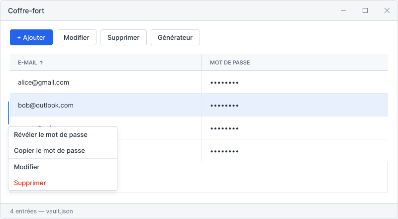
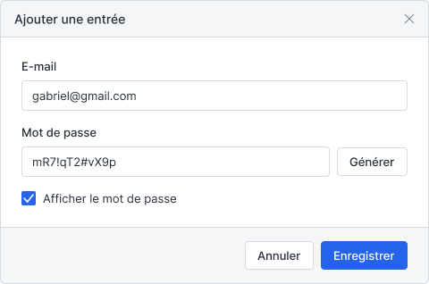
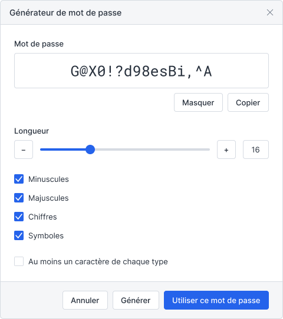

# Gestionnaire de mots de passe — TP1

**Auteur :** Franck Junior — 2544779 — GitHub : [itsfranck](https://github.com/itsfranck)

Application Python de génération et de gestion de mots de passe.

- **Partie 1 :** logique de génération (`app/core/`) et interface en ligne de commande (`main.py --no-gui`).
- **Partie 2 :** interface graphique PySide6 (`app/ui/`) avec un coffre-fort sauvegardé dans un fichier JSON.

## Prérequis

- Python 3.13 ou plus récent
- [uv](https://docs.astral.sh/uv/) pour la gestion de l'environnement virtuel et des dépendances (PySide6)

## Installation

```bash
git clone https://github.com/itsfranck/Tp1-gestionaire-mdp.git
cd Tp1-gestionaire-mdp
uv sync
```

## Utilisation

### Mode graphique (par défaut)

```bash
uv run main.py                          # utilise vault.json
uv run main.py --vault_file perso.json  # utilise un autre fichier JSON
```

**Fenêtre principale (coffre-fort)**

- **+ Ajouter** : ouvre le formulaire (e-mail et mot de passe). Le bouton **Générer** ouvre le générateur et remplit le mot de passe.
- **Modifier / Supprimer** : agissent sur la ligne sélectionnée (clic sur une ligne). La suppression demande une confirmation.
- **Générateur** : ouvre le générateur seul.
- **Trier A→Z / Z→A** : trie la liste par e-mail ; chaque clic inverse l'ordre.
- Les mots de passe sont masqués (`********`). Un **double-clic** les affiche pendant 5 secondes.
- Le **clic droit** permet de révéler, copier, modifier ou supprimer une entrée.
- Les données sont **chargées au démarrage** et **sauvegardées à la fermeture**. Si le fichier est corrompu, un message s'affiche et le coffre démarre vide.

**Générateur**

- Longueur choisie avec le curseur ou les boutons − et + (de 4 à 64).
- Types de caractères à cocher, et option « au moins un caractère de chaque type ».
- Boutons **Masquer / Afficher** et **Copier**.

### Mode ligne de commande

```bash
uv run main.py --no-gui [options]
```

| Option | Description |
|---|---|
| `--no-gui` | Lance le mode ligne de commande au lieu de l'interface |
| `--length N` | Longueur du mot de passe (par défaut : 16) |
| `--no-lower` | Exclure les lettres minuscules |
| `--no-upper` | Exclure les lettres majuscules |
| `--no-digits` | Exclure les chiffres |
| `--no-symbols` | Exclure les symboles |
| `--validate` | Exiger au moins un caractère de chaque type sélectionné |
| `--vault_file F` | Fichier JSON du coffre (par défaut : `vault.json`) |

### Exemples

```bash
# Mot de passe de 16 caractères avec tous les types
uv run main.py --no-gui

# Mot de passe de 12 caractères sans symboles, avec validation
uv run main.py --no-gui --length 12 --no-symbols --validate

# Code de 6 chiffres seulement
uv run main.py --no-gui --length 6 --no-lower --no-upper --no-symbols
```

Si la configuration est impossible (aucun type sélectionné, ou longueur trop courte pour la validation), un message d'erreur est affiché.

## Structure du projet

```
Tp1-gestionaire-mdp/
├── .gitignore
├── pyproject.toml
├── uv.lock
├── main.py                 # Point d'entrée (mode GUI ou CLI)
├── README.md
├── doc/                    # Maquettes de l'interface
└── app/
    ├── __init__.py
    ├── core/               # Logique métier
    │   ├── __init__.py
    │   ├── generator.py    # Classe PasswordGenerator
    │   └── storage.py      # Classe VaultStorage (fichier JSON, ajout, modification, suppression, tri)
    └── ui/                 # Interface graphique
        ├── __init__.py
        ├── generator_ui.py # GeneratorDialog (fenêtre du générateur)
        ├── entry_row.py    # EntryRow (une ligne de la liste)
        ├── entry_dialog.py # EntryDialog (formulaire ajout / modification)
        ├── main_window.py  # MainWindow (fenêtre du coffre-fort)
        └── style.py        # Feuille de style commune
```

## Maquettes

### Fenêtre principale (coffre-fort)

Liste des entrées avec les mots de passe masqués, boutons de gestion et menu contextuel (clic droit).



### Ajouter une entrée

Saisie de l'e-mail et du mot de passe, avec le bouton « Générer » qui ouvre le générateur.



### Générateur de mot de passe

Longueur (curseur et boutons − / +), types de caractères, masquer/afficher et copier.

